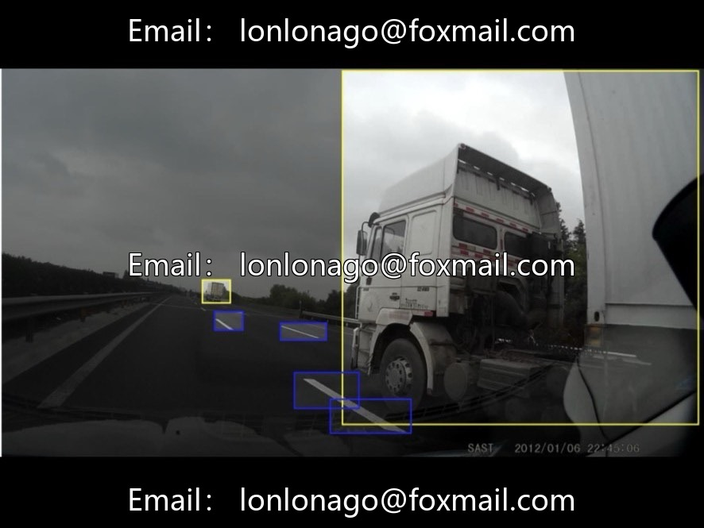
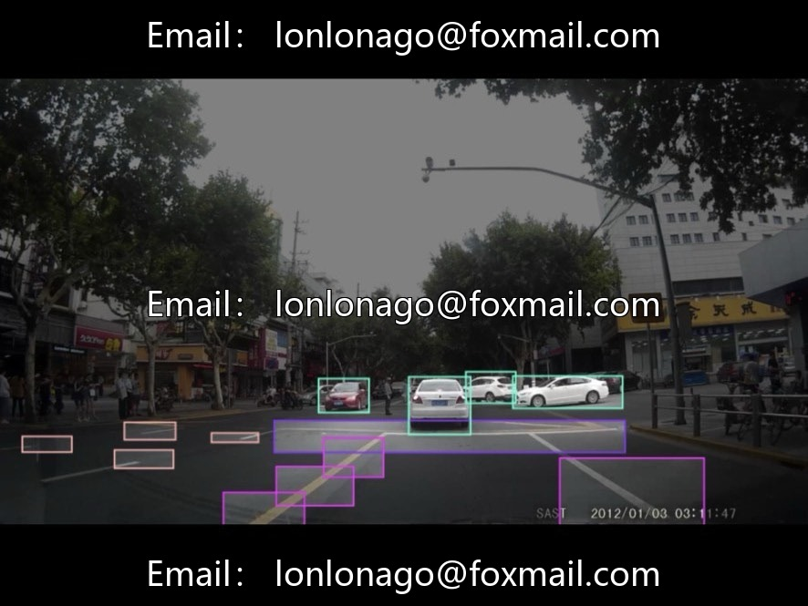
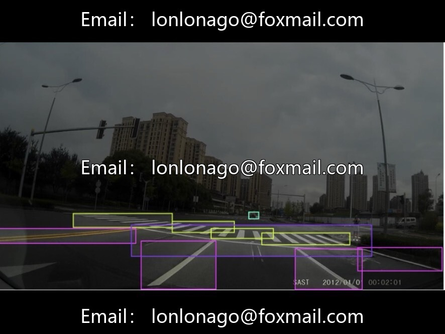

# Highway Obstacle Detection Dataset Based on YOLO, Issue 10740, Domestic Urban

## Body

Highway Obstacle Detection Dataset based on YOLO, 10740th issue, domestic urban road scene, suitable for intelligent driving, autonomous driving environment perception, lane keeping, automatic parking, traffic scene understanding and other tasks.

The dataset consists of over 2780 images, labeled in standard YOLO format with corresponding image and annotation files. It includes 25 classes of targets: three types of motor vehicles (cars, trucks, buses), as well as various traffic signs and backgrounds. The dataset is divided into training set and validation set, accompanied by the china_traffic.yaml configuration file. The file structure is clear and directly usable.

Complementary YOLOv2.6 model training and inference code, with Chinese comments, customizable training parameters and input dimensions, default GPU training, inference outputs target class and detection box coordinates.

Virtual materials, once sold, are non-refundable.
Interested friends, click "I want" to proceed.

## Images

## Payment

Here is a pay link on Stripe ( https://buy.stripe.com/3cs8yP7sY87d0vu9AB ). Please contact me lonlonago@foxmail.com after funding $89, and I will send you a complete data files , thank you!

